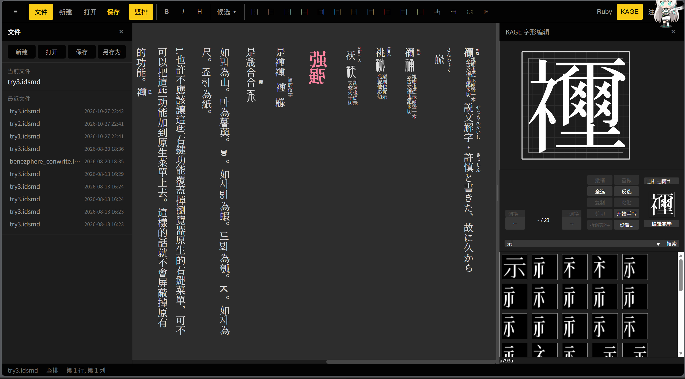

# IDSmd——IDS 组字引擎与编辑器

> ## ⚠️ 本项目是**毛胚品**（early prototype / work in progress）
>
> - **未完成**，功能、API、数据结构、文件位置都还会变，**不要依赖当前形态**；
> - 目前的完成度是"算法验证跑通 + 编辑器能用"，不是"可以出字库"；
> - 已知问题见 §「已知问题」，下一步计划见 §「进度与计划」；
> - 只有确信能跑通的部分才写在这里 —— 没写的就是没做。
> - 这是一项C++课程设计的延伸，使用agent移植到web应用，所以会有一些旧实现的残留。此为学生项目

用 **KAGE 笔画数据** 把一个 IDS（Ideographic Description Sequence，如 `⿴代物`）
合成为一个字形，并提供 Markdown 编辑器做所见即所得的预览。
- 支持裸ids输入自动识别边界自动合成
- 支持入库字符ids识别替换
- 支持右键在kage引擎编辑合成字符并保存
- 具有完整的文件系统可重复打开，可复制为ids表达式
- 实现部分markdown语法，比如四级标题、粗体、斜体、注释
- 快捷键输入ids符号、ipa符号
- 内置谚文-cjk输入法、古谚文输入法、音/训读输入法、喃字输入法
- 可设置多字、单字Ruby，ruby可编辑
- 可设置双行小字夹注
- 可横行、纵列切换

本项目的重点是**组字的几何求解**：不依赖从字体里学习放置，而是从**容器自身的墨迹**
求出部件之间的比例和避让距离，以及包围部件的内腔，以安排各种部件的空间关系。

## 目录

```
web/                     编辑器 (Vite + React 19 + TypeScript)，vibe的
  src/editor/
    kageEngine.ts        KAGE 字形树展开 / IDS → 复合字形 / SVG 渲染
    strokeOutline.ts     笔画中心线采样 → 轮廓 → 单笔包围盒  (对应 scripts/stroke_outer.py)
    cavity.ts            容器墨迹补集的「空腔」枚举        (对应 scripts/cavity.py)
    centralBox.ts        内部件的「中宫盒」                (对应 scripts/central_box.py)
    compose.ts           包围结构的合成流程                (对应 scripts/ids_anal.surround)
    glyphSource.ts       字形数据来源: bundle → 缓存 → GlyphWiki API
  public/data/           词典表 (Unihan 派生, 见 THIRD-PARTY.md §3)
scripts/                 算法的 Python 实验实现，核心算法基本上是人写的 (与 web 端同一套语义)
web/analysis/            对拍 / 评分 / 诊断脚本, 以及 DATA_LAYER.md (数据层契约)
```

## 运行

```bash
cd web
npm install
npm run dev          # 开发服务器 (默认 http://localhost:5173)
npm run build        # tsc -b + vite build
```

### 数据从哪来

**仓库里不带字形数据**。`core_glyphs.json` 有 100+ MB，超过 GitHub 单文件上限，
也不应该进版本库。运行时的回退顺序（`web/src/editor/glyphSource.ts`）：

1. `web/public/core_glyphs.json`（有就用，零延迟）
2. 缓存（内存；可接 IndexedDB）
3. **GlyphWiki API**：`https://glyphwiki.org/api/glyph?name=u4e00`
   —— 该端点带 `Access-Control-Allow-Origin: *`，浏览器可直接取，**纯静态部署可行**

没有 bundle 也能用，只是第一次显示每个字会慢一点（按需取，且取过的会缓存）。

IDS 文本（`cjkvi-ids`，GPLv2）同样不入库；需要时自行下载，或只做字形合成（不需要 IDS 表）。

## 进度与计划

### 已经做到的

| 模块 | 状态 | 依据 |
| --- | --- | --- |
| ⿰⿱⿲⿳ 分配（`layoutRects`） | 移植完成，与 Python **81/81 逐例一致** | `web/analysis/compare_layout.cjs` ① |
| 包围 9 算符的**空腔算法**（`cavity` / `compose`） | 移植完成，与 Python **21/21 逐值一致**（容差 1e-6） | `web/analysis/parity_ts.cjs` |
| 中宫盒（`centralBox`，含 ±15 最小半幅、退化落中心、面积归一） | 移植完成 | 同上 |
| 99 引用 / 接缝拉伸 / 镜像 / 旋转 | 与 `kage-bundle.js` 对齐（忽、鼻、日的回归用例） | `web/analysis/README.md` |
| 字形数据兜底（bundle → 缓存 → GlyphWiki API） | 可用；CORS 已验证 | `glyphSource.ts` |
| Python 侧实验实现（`scripts/`） | 可用，是 web 端的对拍基准 | `web/analysis/parity_gen.py` |

### 下一步（按优先级）

1. **引擎级对拍**：现在只对了「算法层」（同一份笔画输入）。要把 `buildComposite` 的
   取名 + 展平 + 映射整条链与 `ids_anal.IDS` 逐值对拍（⿰⿱⿲⿳ + 9 个包围 × 20 例）。
2. **半包围的空腔改进**：`⿵冂` / `⿷匚` / `⿼叉` / `⿹𬺰` 目前常常求不出候选，退回旧固定矩形。
3. **按内容密度选外框**：库里存在 `-10`（密）/`-11`（疏）/`-15`（罕见）三档包围外框，
   现在只用 `-05`；需要一条"四选一"的判据（可用 NEED 当客观裁判）。
4. **部件比例优化**：包括普通上下左右关系的比例和半包围部件的D-S变换。
5. **`[n]` 槽位选择**（白式 IDS §6.6）：`⿴[1]囗人` 这类显式指定候选的写法尚未支持。
6. **复杂ids表达式结构优化**：实现类似⿸⿰ABC $\to$ ⿱A⿰BC的结构优化
7. **数据层重构**：现状是 import 时 `readlines` 2.48M 行 + 线性扫；索引/分片方案与契约见
   `web/analysis/DATA_LAYER.md`。
8. **编辑器功能**：导出 SVG/PNG、文档保存与分享、快捷键优化、生僻字输入和常态化实现。

### 已知问题（不是待办，是明确知道坏的）

- **bundled 字形数据不完整**：99 引用的目标约一半不在 `core_glyphs.json` 里（`652,985/1,332,102`，
  多为第三方 `ac1-*` 名）。缺目标时现在走「剥后缀到本体」，会少笔画但不至于崩。
- **`-05`/`-06` 覆盖很低**：库里只有 484 / 124 个标准名有这两个后缀（辶、鼻、囗、口 都没有），
  所以这些字即使在包围结构里也仍显示本体 —— 这是数据决定的，不是 bug。
- **性能**：冷启动要读 100+ MB / 2.48M 行；单次合成约 20 ms（腔体枚举占大头）。
- **许可待清**：`web/public/data/` 里词典表的**排序**来源未核实（见 `THIRD-PARTY.md` §3）；
  两张字体许可未查清，因此不入库。

## 算法约定（改代码前请读）

- **99 引用的接缝拉伸**：`(sx,sy)` 是目标、`(sx2,sy2)` 是缝；`sx>100` 时 `sx-=200`。
  写反会让「忽/鼻」这类字反向拉伸。权威实现在 `kage-bundle.js` 的 `getEachStrokesOfBuhin`。
- **名字解析有两条语义**：第一轮叶子查找按位置加后缀（⿰左 `-01`、右 `-02`；⿱上 `-03`、下 `-04`；
  包围容器 `-05`、内部件 `-06`），缺失时**退化到本体**；字形内部引用的递归必须**精确优先**，
  缺失时**剥后缀到本体**（web bundle 不完整，不能跨名字兜"最长子串"，否则会串味/展开成空）。
- **空腔是补集的连通面**，不是最大内接空矩形；安放盒用「面内最大内接矩形」，
  用面的外接框会把容器笔画盖住。
- 数据层的完整契约见 [`web/analysis/DATA_LAYER.md`](web/analysis/DATA_LAYER.md)。

## 许可

- **源代码**：MIT，见 [`LICENSE`](LICENSE)
- **第三方数据/字体**：各自遵守原许可，见 [`THIRD-PARTY.md`](THIRD-PARTY.md)
  ⚠️ `web/public/data/` 里的词典表由 Unihan 派生，但**排序**借用了两处许可证未核实的
  语料频率；严格合规的再分发者请看 `THIRD-PARTY.md` §3 并自行重新生成。
